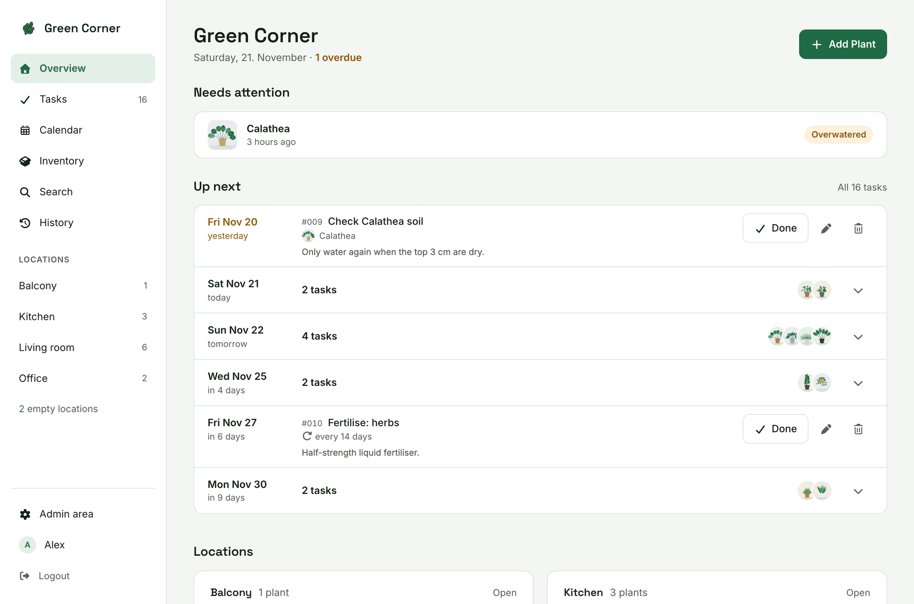
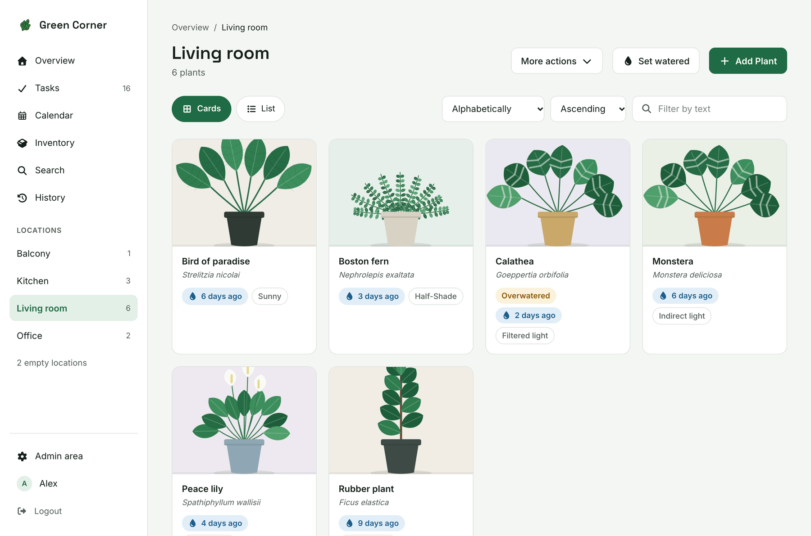
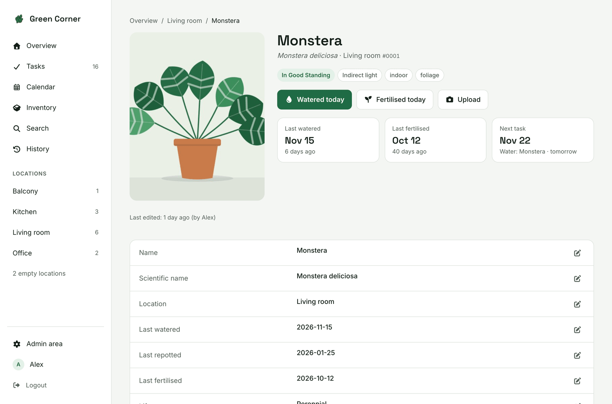
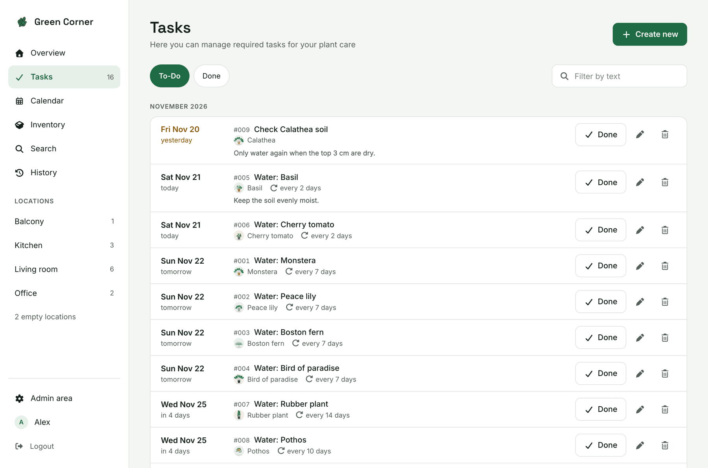
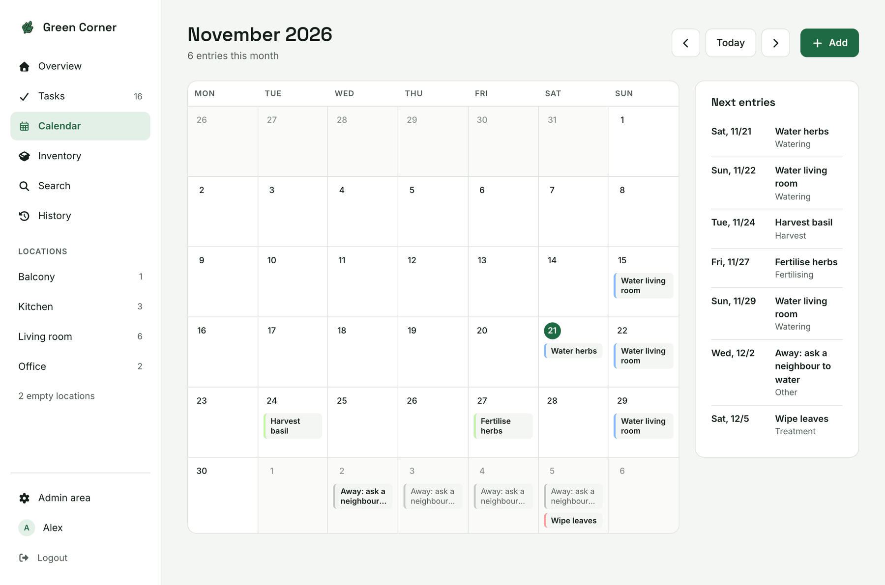
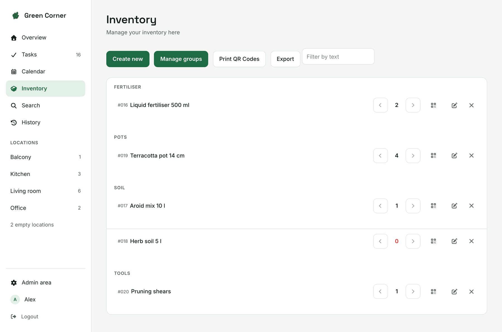
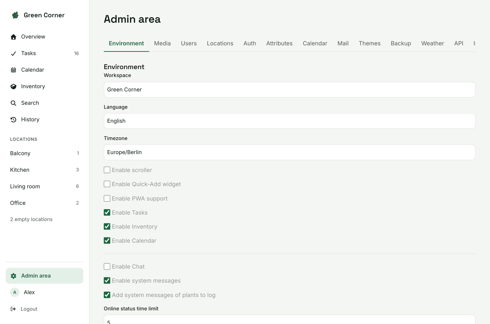
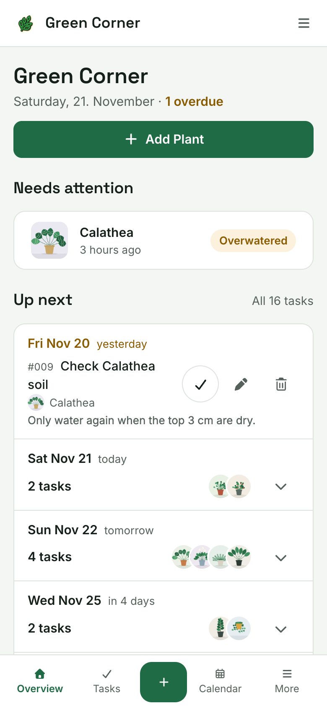
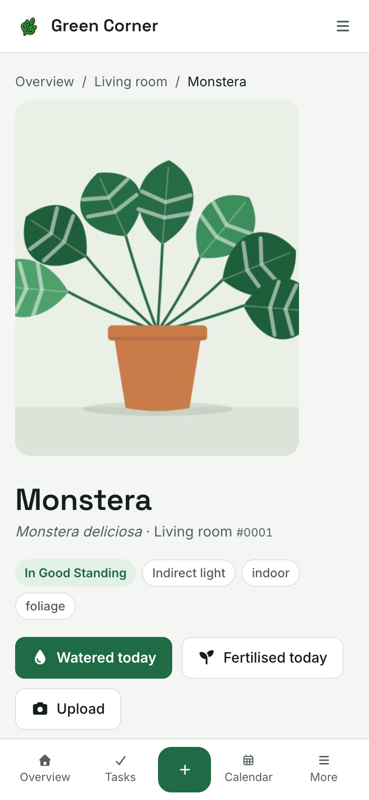
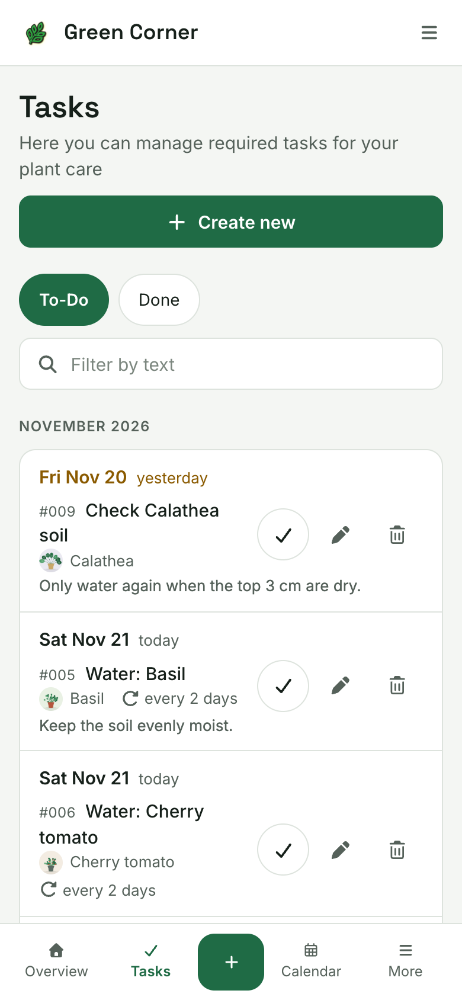

# HortusFox – Tidy UI

A fork of [HortusFox](https://github.com/danielbrendel/hortusfox-web), the self-hosted plant manager,
with a calmer, tidier interface. The backend is **unmodified HortusFox**: same database, same API,
same features. Only the templates and styles differ.



## What is different

- **Sidebar navigation** instead of the top bar and banner; locations with their plant count are always one click away, empty locations are folded away.
- **Overview that answers "what is next?"**: open tasks grouped by day, plants that need attention, and every location with its plants.
- **Tasks as a list**, grouped by month, with the linked plant, the recurrence and one-click *Done*.
- **Month calendar** instead of the timeline chart.
- **Plant page** with a summary, *Watered today* / *Fertilised today* buttons and the next task on top.
- Light theme, bundled fonts (no requests to third parties), works on phones with a bottom bar.

| Location | Plant |
| --- | --- |
|  |  |

| Tasks | Calendar |
| --- | --- |
|  |  |

| Inventory | Admin area |
| --- | --- |
|  |  |

<p>
  
  
  
</p>

All screenshots show the bundled demo data (fictional plants, generated illustrations).

## How it works

Everything that belongs to this fork lives in [`tidy/`](../tidy):

```
tidy/
  Dockerfile          takes the official HortusFox image and copies the overlay on top
  views/              replacement templates (overview, plants, tasks, calendar, sign-in, navigation)
  public/css/tidy.css the stylesheet, scoped to html.tidy
  public/js/tidy.js   navigation drawer and month calendar
  public/fonts/       Inter and Space Grotesk (SIL Open Font License)
  demo/               throwaway demo instance with sample data
```

No original file is edited. The image build keeps the original templates as `upstream/…`, so pages
that are not redesigned yet (plant attributes, admin area, inventory, search, profile, history, chat,
weather) use the original template, restyled by the stylesheet.

**Updates:** HortusFox backend updates arrive by rebuilding the image – the base is always the
current official image. New *interface* features of HortusFox show up automatically on pages that
use the original template; on redesigned pages they have to be ported by hand.

## Installation

You need Docker with the Compose plugin.

### 1. Get the code

```sh
git clone https://github.com/OWNER/hortusfox-web.git
cd hortusfox-web
```

Replace `OWNER` with the account this fork lives under.

### 2. Configure

```sh
cp tidy/docker-compose.yml tidy/docker-compose.local.yml
```

Open `tidy/docker-compose.local.yml` and replace every `CHANGE_ME`:

| Setting | Meaning |
| --- | --- |
| `APP_ADMIN_EMAIL`, `APP_ADMIN_PASSWORD` | the first administrator account, created on the first start only |
| `DB_PASSWORD` and `MARIADB_PASSWORD` | database password, the same value in both places |
| `MARIADB_ROOT_PASSWORD` | database root password |
| `APP_TIMEZONE` | for example `Europe/Berlin` |

Use letters and digits only for the passwords; the HortusFox start script does not quote them.
Do not commit this file – `*.local.yml` is ignored by git.

### 3. Build and start

```sh
docker compose -f tidy/docker-compose.local.yml up -d --build
```

Open <http://localhost:8080> and sign in with the administrator account from step 2.
The first start takes a moment while HortusFox creates its tables.

### Updating

```sh
git pull
docker compose -f tidy/docker-compose.local.yml build --pull
docker compose -f tidy/docker-compose.local.yml up -d
```

`--pull` fetches the current official HortusFox image, so this updates HortusFox itself as well.

### Switching an existing HortusFox installation

The data format is identical. Point your existing `app` service at the Tidy image and keep
volumes, database and environment as they are:

```sh
docker build --pull -t hortusfox-tidy:latest -f tidy/Dockerfile .
```

Then use `image: hortusfox-tidy:latest` instead of `ghcr.io/danielbrendel/hortusfox-web:latest`.
To go back, switch the image name back; nothing in the database changes.

### Prebuilt image (optional)

If GitHub Actions are enabled on the fork, the workflow *Tidy UI - build image* publishes
`ghcr.io/OWNER/hortusfox-tidy:latest` (owner in lower case) every week and after each change.
A second workflow, *Tidy UI - sync with upstream*, merges the original repository weekly and lists
changed original templates in its run summary.

## Try it with demo data

```sh
docker compose -f tidy/demo/docker-compose.yml up -d --build
tidy/demo/seed.sh
```

Open <http://127.0.0.1:8090>. The demo account is defined in `tidy/demo/docker-compose.yml`;
it is bound to localhost and meant to be thrown away:

```sh
docker compose -f tidy/demo/docker-compose.yml down -v
```

## Good to know

- Tested against HortusFox 6.4 and the current development branch.
- HortusFox themes are not loaded; the Tidy UI replaces the banner and colours.
- Interface texts added by this fork are available in English and German (`tidy/views/tidy/lang/`); other languages fall back to English for those few strings.
- Use HortusFox's own documentation for everything else: configuration, cronjobs, API, backups.

## Credits and licence

HortusFox is created by Daniel Brendel and published under the MIT licence, see
[LICENSE.txt](../LICENSE.txt). The Tidy UI overlay is published under the same licence.
Fonts: Inter and Space Grotesk, SIL Open Font License (licence texts in `tidy/public/fonts/`).
This fork is not affiliated with the HortusFox project.

---

The original project README follows in [README.md](../README.md).
